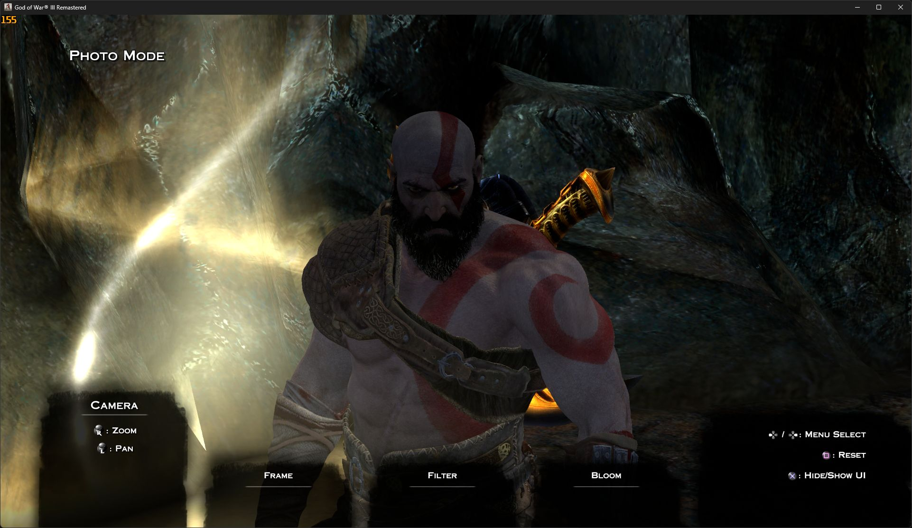

# Kratos 2018 for God of War III PC

A work-in-progress visual replacement that brings the bearded **God of War (2018) Kratos** head, body and outfit to **God of War III Remastered running through the unofficial gow3_pc Windows port**.

**V28 — first public preview.** This is a character mod, not a standalone game, an official PC release, or a gameplay overhaul.

**[Download the mod](https://github.com/ErdemYaziciOfficial/gow3-kratos-2018/releases)** · [Türkçe kurulum](#türkçe) · [Port project](https://github.com/FelipePrado0/gow3_pc)



## What is included?

- Bearded 2018 head, eyes, body and outfit adapted to the GOW III character.
- Neck, shoulder, back and waist fitting adjustments.
- Higher-resolution texture transfers and skin-detail work. Resolution alone does not guarantee additional source detail.
- A separate main-menu lighting adjustment.
- Launcher mod support: enable or disable the character with one checkbox.

## Compatibility and testing

Tested with **CUSA01623, update 01.02**, on the author's existing Windows gow3_pc installation. Other regions, game revisions and port builds are **unverified**. This is not a shadPS4/RPCS3 installation package.

The character was visually checked in the menu and Hades gameplay during development. The final launcher package was checked by starting the normal launcher, inspecting the menu, and verifying that all three replacement files matched the accepted V28 assets. The final packaging run did not repeat the gameplay check. **A complete playthrough has not been tested.**

## Installation

1. Have your own compatible game dump and a working gow3_pc installation. Launch the unmodified game successfully first.
2. Close the game and launcher. Back up your existing `scripts/mods.py` before installing, especially if your port version differs.
3. Download **Kratos-2018-V28-Launcher.zip** from **Releases**. GitHub's automatically generated “Source code” ZIP is not the playable mod package.
4. Extract the release ZIP **into your `gow3-windows` folder**, beside `God of War III.exe`. Merge the `mods` and `scripts` folders and replace `scripts/mods.py` with the supplied version.
5. Open the launcher → **Game / Oyun → Mods / Modlar**. Leave the mods folder at its default, or copy the mod into your custom mods folder.
6. Enable **Load mods / Modları yükle** and **Kratos 2018 - V28**. Click **Refresh / Yenile** if necessary, then **Save / Oyna**.

Expected layout:

```text
gow3-windows/
  God of War III.exe
  scripts/
    mods.py
  mods/
    Kratos 2018 - V28/
      dvdroot_ps4/
        EXEC/
          DEV/LOCALWADS.DCS
          WAD/PS4_LE/R_HERO00.WAD
          WAD/PS4_LE/SHELL.WAD
```

**Why replace the loader?** This launcher build discovers `dvdroot_ps4` mod folders, while GOW III stores these assets under `EXEC`. The supplied loader maps the package's `dvdroot_ps4/EXEC` files to the game's `EXEC` path using a temporary overlay. Original game assets are not overwritten. Do not move these files directly into your game dump.

This launcher uses loose mod folders; dragging the ZIP onto the launcher is not supported. Keep all three asset files together: `LOCALWADS.DCS` supplies the larger character memory budgets, `R_HERO00.WAD` contains the character, and `SHELL.WAD` contains the menu adjustment.

## Disable, uninstall and updates

- **Disable:** uncheck **Kratos 2018 - V28**, save, and restart the game.
- **Uninstall:** close the game/launcher, remove only this mod's folder, and restore your own backed-up `scripts/mods.py` if desired.
- The included `.bak` loader is from the author's tested installation; it is not necessarily the correct backup for a different port version.
- Port updates may replace the loader. Check compatibility before reinstalling this older script over a newer port.
- Mods replacing any of the same three files conflict; later-loaded files win. This package does not merge WAD contents with other mods.

## Known limitations

- **Prerendered cutscenes still show the original GOW III Kratos.** The mod does not replace video files.
- **No Leviathan Axe, new moves, new weapons or gameplay changes.** GOW III's existing weapons remain.
- **No new cloth physics system.** Clothing follows adapted GOW III skinning/weights; it is not a recreation of the 2018 cloth simulation.
- Facial animation is not a complete recreation of the 2018 facial rig.
- Lighting/material response differs from the 2018 game. The menu has its own adjustment; appearance can vary between scenes.
- Some animation poses or untested scenes may still show clipping, seams or deformation. Please include a screenshot and location when reporting these.
- Alternate unlockable costumes and all cutscene/level combinations have not been exhaustively tested.

## Troubleshooting

**Not listed:** check for an accidentally nested extraction folder; verify the layout above, click Refresh and restart the launcher.

**Listed but unchanged:** check both enable boxes, restore the supplied loader if a port update replaced it, and check for conflicting mods. `user/last_run.log` should include `Mods: Kratos 2018 - V28: 3 files` and `Mods: 3 game files replaced, 0 added` when this is the only active mod.

**Crash or missing character:** disable the mod and compare with the unmodified game. Confirm the game revision, all three files and the required loader are present. Do not change memory/graphics settings blindly.

For issues, include game title ID/update, port release, scene/save location, other active mods, and a screenshot. Remove personal paths or other private information from any log excerpts before posting.

## Credits and licensing

- God of War, Kratos and the original game/model/texture assets belong to their respective rights holders, including Sony Interactive Entertainment and Santa Monica Studio. This is an unofficial fan modification with no affiliation or endorsement.
- 2018 model source used for this adaptation: [Gustavopredador's Kratos XPS/XNALARA conversion](https://www.deviantart.com/gustavopredador/art/God-of-War-2018-PS4-KRATOS-XPS-XNALARA-ASCII-862533634).
- PC port and original mod-loader code: [FelipePrado0/gow3_pc](https://github.com/FelipePrado0/gow3_pc) and its contributors.
- Adaptation/testing: **ErdemYaziciOfficial**, developed with Codex assistance.

`mods.py` and its included upstream backup retain **GPL-2.0-or-later** licensing; see `COPYING-loader.txt`. That code license does **not** license the proprietary game/model/texture assets. No ownership of those assets or blanket redistribution permission is claimed here.

## Türkçe

Bu mod, **God of War III Remastered'ın gayriresmî gow3_pc Windows portuna** God of War 2018'deki sakallı Kratos'un kafa, gövde ve kıyafet görünümünü aktarır. Tek başına oyun değildir. **V28 ilk herkese açık önizlemedir.**

### Kurulum

1. Oyun ve launcher'ı kapat. Mevcut `scripts/mods.py` dosyanı yedekle.
2. **Releases** bölümündeki **Kratos-2018-V28-Launcher.zip** dosyasını indir. “Source code” ZIP'ini indirme.
3. ZIP içeriğini `God of War III.exe` dosyasının bulunduğu **gow3-windows** klasörüne çıkar. `mods` ve `scripts` klasörlerini birleştir; `scripts/mods.py` dosyasını değiştir.
4. Launcher → **Oyun → Modlar** bölümünde **Modları yükle** ve **Kratos 2018 - V28** açık olsun. Gerekirse **Yenile**, ardından **Kaydet / Oyna**.

Launcher ZIP içe aktarmıyor; klasörden mod yüklüyor. Paketteki yükleyici düzeltmesi gerekli. Üç oyun dosyası birlikte kullanılmalı. Orijinal oyun dosyaları değiştirilmez; geçici bir dosya katmanı kullanılır. Kapatmak için modun işaretini kaldırıp oyunu yeniden açman yeterli.

### Neler eksik?

Önceden kaydedilmiş sinematiklerde eski Kratos kalır. Leviathan baltası/yeni oynanış yoktur. Yeni kumaş fiziği veya tam 2018 yüz animasyon sistemi yoktur. Bazı pozlarda taşma/deformasyon olabilir; tüm oyun bitirilerek test edilmedi. Farklı bölgeler, oyun güncellemeleri ve port sürümleri doğrulanmadı. Test edilen oyun **CUSA01623 01.02**; menü ve Hades bölümünde görsel kontroller yapıldı. Son launcher paketinde üç dosya ve menü doğrulandı, oyun içi kontrol o son çalıştırmada tekrarlanamadı.

Aynı dosyaları değiştiren modlar çakışır. Port güncellemeleri yükleyici düzeltmesini silebilir. Sorun bildirirken sahneyi, sürümü ve ekran görüntüsünü ekle; loglardaki kişisel bilgileri paylaşma.
